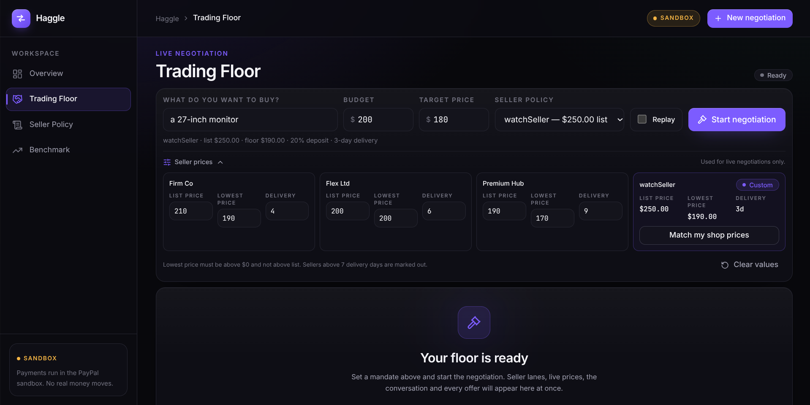
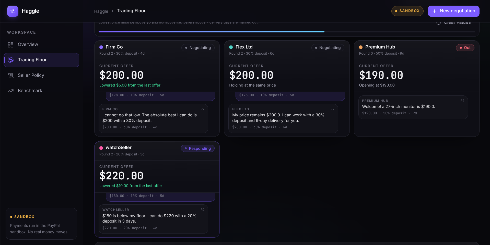
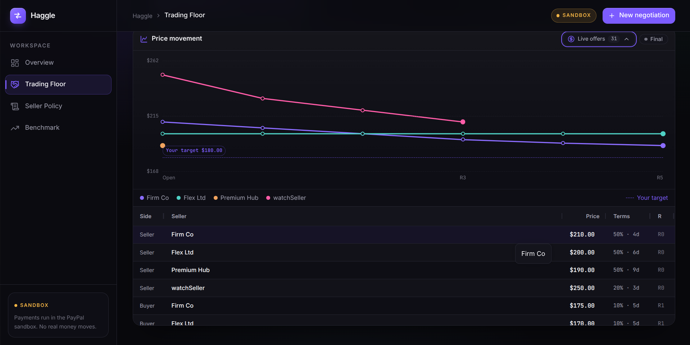
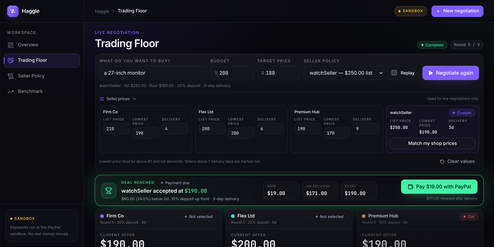
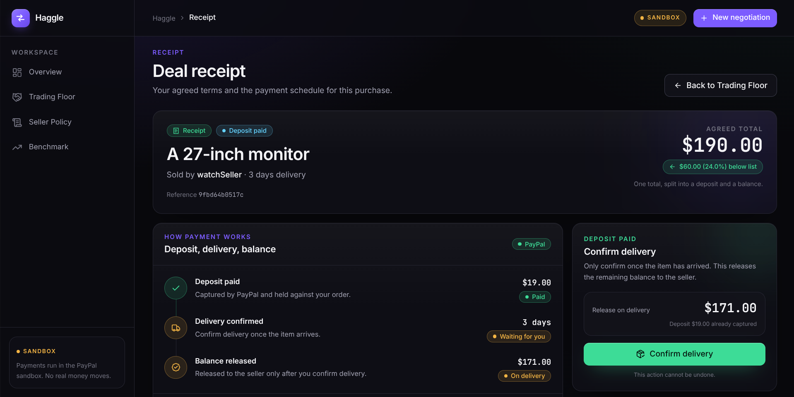
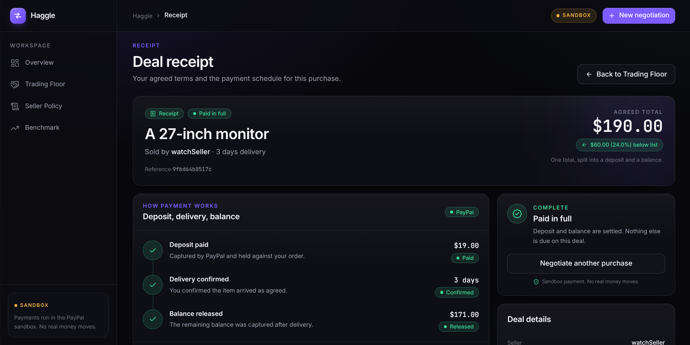

# Haggle

**An AI buyer agent that negotiates price and payment terms with competing seller agents, then settles the winning deal through PayPal.**




Built for the PayPal AI Hackathon ("Build What's Next with PayPal and AI"). Tags: Web, Machine Learning/AI, Low/No Code.

- **Live demo:** https://haggle-5xmi.onrender.com (free hosting tier: the first load after idle can take about a minute)
- **Demo video:** TODO_YOUTUBE_LINK
- **Code:** https://github.com/Aayushmaan-24/Haggle
- **License:** MIT

## What it does

1. A buyer states what they need, a budget, and a target price. That becomes a **mandate** the agent cannot exceed.
2. The buyer agent negotiates in parallel with several seller agents over price, deposit, and delivery time, using real competing offers as leverage.
3. A scoring function ranks the final offers, weighing price, the cost of the deposit, and delivery time. The best deal wins.
4. PayPal settles the deal: the full amount is authorized, the negotiated deposit is captured immediately, and the balance is captured when the buyer confirms delivery.
5. **Seller Console (no code):** a merchant types pricing rules in plain English (for example "never go below 80% of list, I like a 30% deposit, I can ship in 3 days"). The rules compile into a structured policy and become a live seller agent that competes in the same market. The Trading Floor also lets you edit the list and lowest price of every default seller, so a custom seller is compared fairly.
6. **Trading Floor:** the negotiation is shown live, with one lane per seller (price, chat messages, status), a price-by-round chart, and a live offers table built with AG Grid.

## Screens

- **Overview:** what Haggle does and how a negotiation runs
- **Trading Floor:** set a mandate, watch the negotiation, pay the winner through PayPal
- **Seller Policy:** the no-code console that compiles plain-English rules into a seller agent
- **Benchmark:** recorded results of randomized purchases
- **Receipt:** agreed terms and the deposit and balance status of a deal

## Screenshots








## Why the agents are safe

The language model writes the messages, but **code makes every decision that matters**:

- A seller offer below the seller's floor is rejected and corrected in code.
- A buyer acceptance above the budget, or above the target price while rounds remain, is blocked in code.
- The buyer may only quote competing prices that another seller actually offered. Messages that cite invented numbers are rewritten.
- A seller cannot claim a delivery time it cannot meet.
- The server stores the winning deal, so a browser cannot send a fake price to PayPal.
- Compiled seller policies are clamped to valid ranges (the floor can never exceed the list price).

## Tools and how they are used

| Tool | Use |
|---|---|
| PayPal Developer Platform (sandbox) | Orders API v2 with `AUTHORIZE` intent, one payee account per seller, partial captures for the deposit and the balance |
| Google Gemini API (free tier) | Buyer and seller agent messages, and plain-English-to-policy compilation. Primary model `gemini-3.5-flash-lite`, with automatic fallback to other Flash-Lite models |
| FastAPI | Negotiation orchestrator, streaming API (server-sent events), payment endpoints, and static hosting of the frontend |
| Next.js, Tailwind CSS | Trading Floor, Seller Console, Benchmark, and Receipt screens (static export served by FastAPI) |
| AG Grid Community | Live offers table on the Trading Floor and the benchmark scenarios table |
| Render | Hosting (free tier) |

## Testing the payment (for judges)

The app uses the PayPal **sandbox** only, so no real money moves. A sandbox buyer login for judges is provided in the Devpost submission's testing instructions.

1. Open the live demo and go to **Trading Floor**.
2. Click **Start negotiation**. If the AI service is busy, tick the recorded negotiation option for an instant run.
3. When the winner appears, click **Pay deposit with PayPal** and log in on the PayPal sandbox page with the provided buyer account.
4. After approval you land on the receipt. Click **Confirm delivery** to release the balance.

Deals belong to the browser that created them (an anonymous, signed cookie — there is no login). The backend keeps them in memory only, so a restart clears its copy; your browser keeps a saved copy of each one, and the receipt and Recent Deals fall back to it with the payment status clearly marked as unverified. Payment and delivery are only possible while the backend still has the live record.

## Run it yourself

You need Python 3.11+, Node.js 20+, a free PayPal Developer account, and a free Gemini API key.

1. In the PayPal Developer Dashboard, create **1 Personal and 3 to 4 Business sandbox accounts in the United States** (India-based sandbox accounts cannot make domestic payments), then create a Merchant REST app and note its Client ID and Secret.
2. Clone the repo and set up the backend:

```bash
git clone https://github.com/Aayushmaan-24/Haggle.git
cd Haggle
python3 -m venv .venv && source .venv/bin/activate
pip install -r backend/requirements.txt
cp .env.example .env
```

3. Fill in `.env`:

| Variable | Meaning |
|---|---|
| `PAYPAL_CLIENT_ID`, `PAYPAL_SECRET` | Credentials of your sandbox REST app |
| `GEMINI_API_KEY` | Your Gemini API key |
| `GEMINI_MODEL` | Primary model, default `gemini-3.5-flash-lite` |
| `SESSION_SECRET` | Long random string used to sign the anonymous browser-identity cookie. Generate one with `python -c "import secrets; print(secrets.token_urlsafe(48))"`. Changing it signs everyone out and orphans existing in-memory deals. |
| `SELLER_EMAIL_FIRM_CO`, `SELLER_EMAIL_FLEX_LTD`, `SELLER_EMAIL_PREMIUM_HUB` | Emails of three US Business sandbox accounts, one per default seller |
| `SELLER_EMAIL_CUSTOM` | Email of a fourth Business sandbox account, used when a custom seller wins |
| `PUBLIC_BASE_URL`, `FRONTEND_URL` | Where PayPal sends the buyer back. Use `http://localhost:8000` for both when running locally |

4. Build the frontend. The backend serves the static export from `frontend/out`:

```bash
cd frontend
npm ci
npm run build
cd ..
```

5. Start the server and open http://localhost:8000:

```bash
cd backend
uvicorn app:app --reload --port 8000
```

6. Or try the API directly:

```bash
curl -N "http://localhost:8000/api/negotiate"                # live negotiation (uses Gemini)
curl -N "http://localhost:8000/api/negotiate?replay=true"    # recorded negotiation, no model calls
```

For frontend development, run `npm run dev` inside `frontend/` (port 3000) while the backend runs on port 8000, and set `FRONTEND_URL=http://localhost:3000` in `.env`.

### Deploying to Render

- Build command: `pip install -r backend/requirements.txt`
- Start command: `cd backend && uvicorn app:app --host 0.0.0.0 --port $PORT`
- Add every variable from `.env.example`, with `PUBLIC_BASE_URL` and `FRONTEND_URL` set to your Render URL (no trailing slash). Set a long random `SESSION_SECRET` there too — without it the app falls back to an ephemeral secret and every restart gives browsers a new identity.
- `frontend/out` is committed to the repository, because the build command does not build the frontend. Rebuild and commit it after every frontend change.

## API

| Endpoint | Purpose |
|---|---|
| `GET /api/negotiate` | Streams negotiation events. Params: `item`, `budget`, `target`, `policy_id`, `prices`, `replay` |
| `POST /api/policy/compile` | Turns plain-English seller rules into a policy and returns a `policy_id` |
| `GET /api/deals` | Lists this browser's deals, newest first. Param: `limit` |
| `GET /api/deals/{id}` | Reads a deal owned by this browser; anything else is a 404 |
| `POST /api/deals/{id}/pay` | Creates the PayPal order and returns the approval URL |
| `GET /paypal/return` | PayPal redirect: authorizes the order, captures the deposit, and redirects to the receipt. The signed `state` parameter must match the deal owner |
| `POST /api/deals/{id}/deliver` | Confirms delivery and captures the balance |

Deal endpoints identify the caller with an anonymous `haggle_uid` cookie: a random id signed with `SESSION_SECRET` and set `HttpOnly`. Every deal records its owner, and listing, reading, paying, delivering and completing a PayPal return all require the same owner. No account or login is involved.

`prices` is a JSON object that overrides a default seller's prices, for example `{"Flex Ltd":{"list":120,"floor":90}}`. The floor must be above 0 and not above the list price.

### Negotiation events

`GET /api/negotiate` sends server-sent events with these types: `round`, `offer`, `status`, `result` (includes the ranking, the winner, and a `deal_id`), `notice` (shown when the app falls back to a recording), `reset`, and `error`.

## Results

`backend/benchmark.py` runs randomized purchases (fixed seed, so the scenarios are reproducible) and checks every winning deal against the buyer's budget, the winner's price floor, and the delivery deadline. Results are in `data/benchmark.json` and are shown on the Benchmark page.

Across **7 completed runs**: 100% of negotiations closed a deal within the buyer's mandate, the winning price averaged **8.3% below the winner's list price** and **6.6% below the cheapest seller's list price**, and there were **0 guard violations**.

These numbers describe this agent on these simulated scenarios. The buyer's target price is set at 94% of its budget in the benchmark, and model output varies from run to run, so treat them as a demonstration, not a market-wide claim.

To reproduce: `cd backend && python benchmark.py 8` (takes a while on free-tier model limits).

## Limitations

- The default sellers are simulated agents with synthetic catalogs. The Seller Console shows how a real merchant would plug in.
- Payments run in the PayPal **sandbox** only. No real money moves.
- Deals and compiled policies are kept in server memory (Render's free disk is ephemeral), so a server restart clears the server's copy. Each browser keeps a localStorage copy of its own deals for display, so history stays readable, but this is not a database and payment status in a saved copy is unverified.
- Identity is per browser: clearing cookies or using a different browser/device starts a new anonymous identity and will not show earlier deals.
- Free-tier Gemini limits can slow or interrupt live negotiations. When that happens the app falls back to a recorded negotiation (`data/replay.json`) and tells the user.

## License

MIT. See `LICENSE`.
